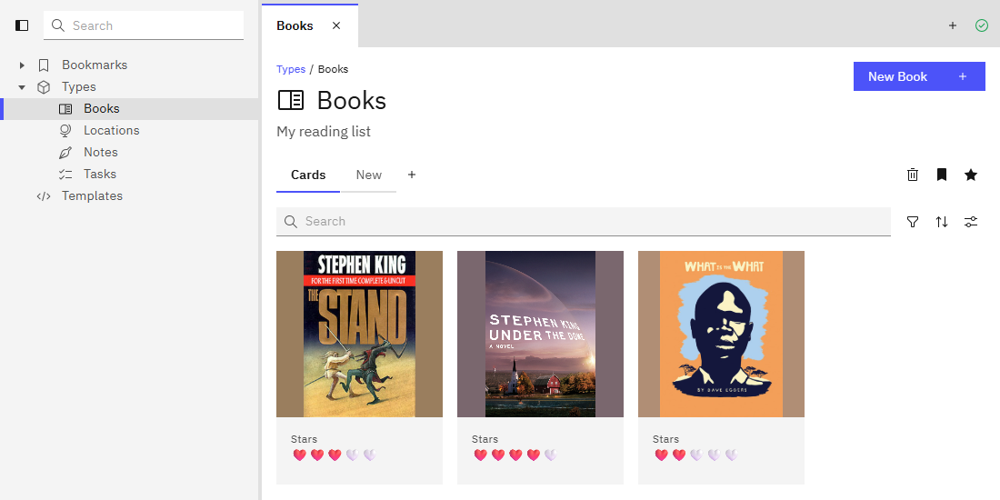

# Kubus

Kubus is a personal knowledge manager like Obsidian, but backed by a relational store instead of
Markdown files. You define your own collections (Books, People, Meetings, …) with the fields you
want, and fill them with items that link to each other.



## Highlights

- **Your own schema.** Create collections with any fields: text, Markdown, numbers, dates, checkboxes,
  images, links to other items, lists, checklists and computed component fields.
- **Views.** Show a collection as a table or as cards, with filters, sorting and grouping. Save as many
  views per collection as you like, star a default, bookmark the ones you use most. Item pages
  get views too: which fields show, in which order.
- **Edit in place.** Click any field to edit it, no forms or save buttons.
- **Markdown (GFM) editor**: type your formatting, paste or drop images.
- **Components.** `{{ … }}` sections of JavaScript compute values, render Markdown or HTML, and are
  reusable across collections.
- **Spaces.** Keep work and private apart: each space has its own items, views, bookmarks and tabs,
  while collections and components are shared.
- **Global search** across all items of a space.
- **Workspace.** Tabs and tiled panes, side by side, like an editor.
- **Local first.** Everything runs offline on a SQLite database in the app itself.
- **Sync.** Optionally sync every device with your own server backed by Postgres.
- **HTTP API and webhooks.** The server lets scripts and automation tools do everything the app does
  (`/api/v1`), is an MCP server for assistants such as Claude (`/api/v1/mcp`), and can call a webhook on
  every change (Help → API in the app).
- **Everywhere.** A desktop app (Tauri) for Windows, macOS and Linux, and the same build as an
  installable web app on your phone (iOS home-screen app).
- **Compact, themed UI** built with the Carbon Design System; follows your OS light / dark theme.

## Setup

### Desktop app

Download it from the [Releases page](https://github.com/maakbaas/kubus/releases); each release is
built from a version tag (`v1.2.3`). Data stays on your device, in the app's own database.

- **Windows**: the installer (`.exe` / `.msi`) or the portable `kubus.exe`, which needs no
  installation (it uses the WebView2 runtime that Windows 10/11 ships with).
- **macOS**: the `.dmg` (Apple silicon and Intel). It isn't notarized, so the first time macOS
  refuses to open it: open it anyway under System Settings → Privacy & Security, or run
  `xattr -cr /Applications/Kubus.app`.
- **Linux**: the `.deb` (Debian, Ubuntu), `.rpm` (Fedora) or the `.AppImage` (any distribution).

### Build it yourself

You need [Node.js](https://nodejs.org) 22 or newer and the
[Tauri prerequisites](https://tauri.app/start/prerequisites/) (a Rust toolchain, plus WebView2 on Windows).

```
npm install
npm run dev:web     # the app in a browser at http://localhost:1420
npm run dev         # the desktop app with hot reload
npm run build       # the executable and installers: desktop/target/release
```

`npm run build:web` builds just the web app to `app/dist`.

### Sync server (optional)

Kubus works fully offline. To keep several devices in sync, and to use the app from your phone, run
the server: it syncs through a Postgres database and also serves the web app.

1. Copy `docker-compose.yml` to the machine that will host it.
2. Change `KUBUS_TOKEN` (a long random secret shared by your devices) and the Postgres password
   (in both `POSTGRES_PASSWORD` and `DATABASE_URL`).
3. Run `docker compose up -d`. The server listens on port 8080. Update later with
   `docker compose pull && docker compose up -d`.
4. In the app, open Settings → Server, enter the server's address and the token ("Test connection"
   checks both), save, then turn sync on in Settings → Sync (or "Configure sync" under the status icon
   at the top right).

To use an existing Postgres instead, remove the `db` service and point `DATABASE_URL` at it. For
the phone (an installable home-screen app) and the desktop app, put the server behind HTTPS, for
example with Caddy, Tailscale Serve or a Cloudflare tunnel.

The same server answers an HTTP API at `/api/v1` (and MCP at `/api/v1/mcp`) with an API token made in
Settings → API tokens (read, or read & write; the devices' token works too), and calls `KUBUS_WEBHOOK_URL`
on every change when set (commented in `docker-compose.yml`); Help → API in the app documents both.
In the app, the server's own settings set up what it offers every device: a language model
(Settings → AI → "The server's", used through the server so the key stays there; a device can still
set its own instead) and remote sources (Settings → Connections), databases the server reads (read-only: Postgres, MySQL / MariaDB, n8n, InfluxDB 2, Cloudflare D1, Actual Budget, ICS calendars, JSON and CSV over HTTP) for remote
collections. Both are stored on the server only; keys and passwords are never shown again, and
with `KUBUS_SECRET_KEY` set (commented in `docker-compose.yml`) they are stored encrypted.
The API's copy of your data (the *headless device*) is kept in `KUBUS_HEADLESS_DIR` (`/data/headless` in the image,
a volume in `docker-compose.yml`), so after a restart the API answers at once instead of downloading everything first;
it is only a cache, and one server may use the directory. Unset, it is kept in memory.
Running the server from the repository instead of the image: `npm run build:headless` first, or the
API answers 503.

## Where your data lives

Kubus is local first: your data is a SQLite database inside the app, on the device you use it on. It
leaves that device only when you connect a server. What the database sits in, and so what can make it
disappear, depends on how you run Kubus:

| You run Kubus as | Where the data is | What loses it |
|---|---|---|
| **A website in a PC browser** | The site's private storage (OPFS) in your browser profile, one database per site address: `http://localhost:1420` and `https://kubus.example.com` are two apps. Kubus asks the browser to keep it (`navigator.storage.persist()`); without that the browser may delete it when the disk runs low. | Clearing the site's data or cookies; a private window (when it closes; some browsers don't offer storage there at all, and Kubus then warns that changes are lost on reload); the browser dropping it when the disk is low and it didn't grant to keep it. Another browser, profile or address shows an empty app. Kubus opens in one tab at a time. |
| **The desktop app** (Tauri) | The app's own web view profile: on Windows `%LOCALAPPDATA%\com.kubus.app\EBWebView`. Clearing your browser's data doesn't touch it. | Deleting that folder; uninstalling can remove it, depending on the installer. On macOS and Linux (WKWebView, WebKitGTK) the location is the system web view's and not verified yet. |
| **Safari on iPhone / iPad, in a tab** | Safari's storage for the site. | Safari deletes a site's data after 7 days without a visit, and may evict it when storage runs low. Don't keep data only here. |
| **Chrome on Android, in a tab** | Chrome's storage for the site. | Clearing the site's data; Chrome evicting it under storage pressure unless it granted persistent storage (it decides itself). |
| **The iOS home-screen app** | Its own storage, separate from the Safari tab's: what you entered in Safari is not in it, and the other way round. Exempt from the 7-day rule, and Kubus asks to keep it. | Deleting the icon deletes its data. Storage pressure can still evict it. |
| **The installed app on Android** (Chrome's "Install app") | Chrome's storage for the site, the same as the browser tab's. Chrome usually keeps installed apps' data. | Clearing Chrome's site data; uninstalling the app. |

What protects it:

- **A sync server** (see above): the server holds a copy and every other device that syncs holds one
  too. A device that lost its data connects again and downloads everything.
- **A backup file**: Settings → Backup → *Download backup* saves the whole database as one SQLite file
  (`kubus-backup-2026-10-29.sqlite`): your collections, items, views, components and the images stored on
  that device. Not in it: the device's own AI key and the other preferences that live in the browser, such
  as the server's address and token. Download one regularly and keep it somewhere else (on a PC, in the
  browser's or the desktop app's download folder). *Restore from backup…* replaces everything on the
  device with such a file after asking, and brings a file of an older Kubus up to date; a file of a newer
  Kubus is refused. Sync is switched off after a restore: switching it on again is a first connection
  to the server, which then either replaces the restored data (when it holds data) or receives it (when it
  is empty).
